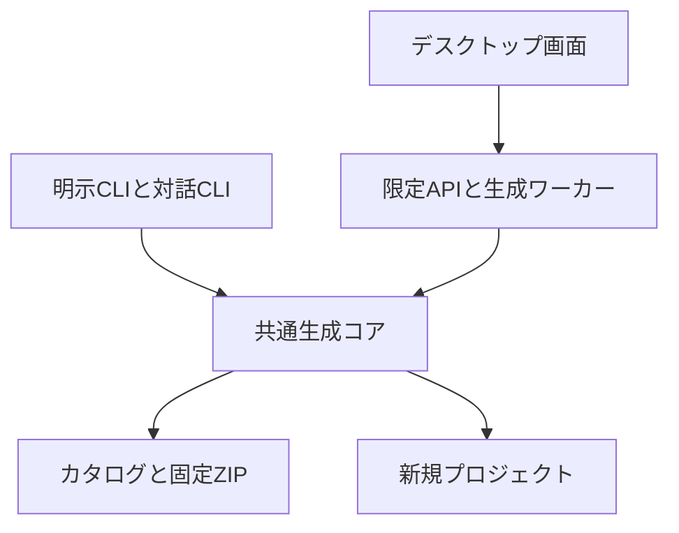

# Dev Containerジェネレーター 次版の要件定義と設計

作成：2026-10-20（日本時間）  
設計版：0.1／実装の目標：generator 0.2.0  
宛先：おとかさん・家のCodex  
基点：`otoka-devcontainer-starters-0.1.1-2026-10-20.zip`  
基点ZIPのSHA-256：`7113c3b50c95dbd7f59201c17a8af6a4bb9ad8d13262247ad1463c7c3f5aaf6a`

**次版は「作りたいものを選ぶ→保存先と構成を確認→新規生成→起動・学習へ進む」までを案内するジェネレーターにする。既存の生成コアを共用し、対話CLIを先に完成させ、その後Linux用デスクトップGUIへ接続する。**

本書は要件・設計・実装依頼であり、次版の実装完了報告ではない。既存テンプレートの実機確認は並行して続ける。

## 1. 目的と判断の前提

対象は、作りたいものがある一方、環境構築で止まりやすい個人・駆け出しエンジニア。生成後に教材を読み、自分で変更できることも重視する。

次版で確かめる価値は次の3点。

- 技術構成の名前を全部知らなくても、目的から入口を選べる。
- 保存先・前提・次の操作が分かり、生成成功後に迷いにくい。
- CLIとGUIで同じ構成・同じ保護処理を使える。

|区分|内容|
|---|---|
|本人が示した方向|用途別テンプレート、フロント／バック／フルスタック、Next.js内API、Supabaseローカル優先、新規中心、教材付き、将来はCLIやデスクトップGUI|
|今回の設計上の既定値|共通コア→対話CLI→Linux GUIの順、日本語、現行6構成、サンプル・テスト・CI同梱、既存フォルダを上書きしない|
|暫定の技術選択|GUIはElectron＋React＋TypeScript。既存Nodeコアを利用するための選択で、本人指定の技術ではない|
|後で決めるもの|製品名、価格、サポート条件、WindowsネイティブGUI、任意構成合成、空構成の派生版|

通常の実装判断は担当Codexが進め、理由をDECISIONSへ記録する。上記の後続事項を待って共通コアや対話CLIを止めない。

## 2. 既にあるものと今回の増分

現行0.1.1には `list / doctor / create`、SHA照合、保存先検査、排他的配置、途中失敗時の変更保護、生成可能な6構成がある。これを基点にする。

|機能|現状|次版|
|---|---|---|
|構成の選択|IDを指定するCLI|用途から選ぶ対話CLIとGUI|
|生成前の確認|独立したプレビューなし|書込みなしのplan、保存先・版・ポート・内容表示|
|生成|固定ZIPから新規配置|既存保護を維持し、planを再検査して配置|
|診断|Docker未接続も一律NG|生成準備と起動準備を区別|
|完了後の案内|コンソール上の説明|構成別の手順＋作成先START_HERE.md|
|GUI|なし|Linux上の小さなデスクトップアプリ|
|既存プロジェクト|別adapterの限定試作|別機能として維持。今回の生成フローへ統合しない|

テンプレート内容を変更しなければ、個別ZIPの版・bytesは維持する。generator版、全体パック版、各テンプレート版を同一に揃える必要はない。

## 3. 選べる構成と選べない項目

|目的表示|構成|伝える内容|
|---|---|---|
|画面を作りたい|F2が初期候補、F1も選択可能|F2はNext.js、F1はReact＋Vite。サンプル画面から変更できる|
|APIを作りたい|B1|Next.jsのAPI。Web画面やDB保存は含まない|
|画面とAPIをつなぎたい|S1|同じNext.js内で画面とAPIを作る。DB保存は含まない|
|データをDBへ保存したい|S2|Next.js＋ローカルSupabase。メモCRUD。ローカル学習用・ログインなし|
|SQL・DBを学びたい|I1|PostgreSQL＋SQL作業環境。Web画面はない|

F1〜I1の教材・テスト・CI設定は固定で同梱する。S3は現状の `generatorEligible:false` を維持し、参考資料として表示する。

次の選択は次版に付けない。

- 「サンプルなし」「テストなし」「CIなし」のチェックボックス。
- 任意のフレームワーク・DB・認証機能の組合せ。
- 既存プロジェクトへ設定を自動マージする操作。
- クラウド登録、デプロイ、課金や購入の処理。

サンプルを消すとテストや教材も変わるため、将来は `minimal / learning / crud` などの**独立して検証した派生構成**を追加する。今は未検証のファイル削除で実現しない。

## 4. 機能要件

|ID|要件|完了条件|
|---|---|---|
|FR01|用途別一覧・構成説明|含まれる機能、準備、検証環境が分かる。S3を作成可能にしない|
|FR02|保存先入力|既存の親フォルダ＋新しい子フォルダ名。既存の空フォルダも拒否|
|FR03|詳細設定|任意の識別ラベル、ホストポート、S2のDB開始ポート。通常は既定値|
|FR04|生成前plan|対象フォルダを書かず、構成・版・絶対パス・ポート・ファイル数を提示|
|FR05|新規生成|再検査後に排他的配置。既存ファイルを上書きしない|
|FR06|準備診断|生成可否と起動準備の確認結果を別表示。Docker未起動でも生成を許す|
|FR07|生成後案内|README、ホストとコンテナ別の次の操作、教材への入口を提示|
|FR08|既存CLI互換|list/doctor/createを残す。createへ追加確認を挟んで既存自動処理を壊さない|
|FR09|対話CLI|用途→構成→保存先→確認→生成。戻る・中止に対応|
|FR10|デスクトップGUI|同じplan/applyを使い、生成処理を画面側で再実装しない|
|FR11|失敗時の案内|日本語で原因と次の操作を示す。保持された途中ファイルの場所も示す|
|FR12|単独配布|CLIとGUIの各配布物が必要なcore・catalog・ZIPを含み、制作者の作業パスに依存しない|

### 入力の意味

- **親フォルダ／新しいフォルダ名**：例 `~/projects` と `はじめての アプリ`。フォルダ名の日本語・空白を許可する。
- GUI／wizardで親フォルダを手入力する場合、先頭の `~/` は実行ユーザーのホームへ展開してから正規化する。`~otheruser` や環境変数は展開しない。明示CLIはシェルから受け取ったパスをそのまま正規化するため、CLI例では絶対パスかシェルで展開される指定を使う。
- **識別ラベル**：省略可能。指定するなら現行の英小文字開始・英小文字数字ハイフン・1〜25文字。フォルダ名とは別項目。
- **ポート**：1024〜65535。S2はshadow/API/DB/Studioに連続4個を使う。開始値は最大65532で、アプリ用ポートと重複させない。
- GUI・wizardの子フォルダ名は1要素のみ。`.`、`..`、区切り文字、制御文字を拒否する。
- CLIのdestinationは従来どおりパスを受け、正規化した絶対パスを確認表示する。親は既存の通常ディレクトリに限定し、symlink親を拒否する。

ポートの既定値はcatalogから取得する。使用中ポートは起動準備の問題として知らせ、利用者が変更できるようにする。診断はその時点の観察で、ポートを予約した保証にはしない。

## 5. 操作画面と対話CLI

GUIは4画面。CLIも同じ順序を使う。

|画面|内容|主な操作|
|---|---|---|
|1 何を作るか|5つの目的、対応する構成の短い説明。画面だけの場合はNext／Viteを選べる|次へ|
|2 どこへ作るか|親フォルダ選択、新しいフォルダ名。詳細設定は折り畳む|戻る／内容を確認|
|3 内容の確認|構成・版、保存先、ポート、同梱内容、生成・起動の準備状況|戻る／この内容で作成|
|4 作成完了|ファイル生成の結果、次に行う操作、READMEと教材|手順を見る／コピー／VS Codeで開く|

フォルダダイアログのラベルは「親フォルダを選ぶ」。作成対象そのものを既存フォルダから選ばせない。

基本文言：

- 選択：「まず何を作りますか？」
- S1説明：「画面とAPIを同じNext.jsプロジェクトで作ります。データの保存は含みません。」
- Docker未起動：「ファイルの作成はできます。コンテナを開く前にDockerの準備が必要です。」
- 完了：「プロジェクトのファイルを作成しました。」
- 既存フォルダ：「この名前のフォルダは既にあります。新しい名前か、別の親フォルダを選んでください。」
- 一部保持：「作成途中のファイルが残っています。表示されたフォルダを確認してください。」

「開発環境が起動しました」は、ファイル生成だけで表示しない。

フォームはラベル、キーボード操作、エラー箇所への移動に対応。色だけで状態を区別しない。戻ったとき入力を保持し、変更後は古いplanを無効にする。

### CLIの提案コマンド

```bash
node generator/cli.mjs list
node generator/cli.mjs doctor
node generator/cli.mjs doctor --scope generation
node generator/cli.mjs wizard
node generator/cli.mjs plan S2 ../my-notes --port 3404 --db-base 54520 --json
node generator/cli.mjs create S2 ../my-notes --port 3404 --db-base 54520
```

- `plan` は標準出力のみ。既定でプランファイルや対象フォルダを書かない。
- `create --expect-plan <planId>` を追加し、事前確認したplanとの一致を指定可能にする。
- `--json` は対応するlist/plan/create/doctorで1つのJSONをstdoutへ出す。進捗や補助ログはstderrへ分ける。
- wizardはTTYがない場合に質問待ちせず、明示引数のcreate利用を案内する。
- 中止は出力先を変更しない。生成開始後は通常の中止操作を無効にし、短い配置処理を完了またはrollbackする。
- 終了コードは成功・生成前中止0、利用条件／入力／診断NG 1、内部処理／書込失敗2、割込み130を基本とする。
- 既存doctorの引数なしは全体診断を維持。Docker未準備なら終了1でも、「生成可能」と「起動準備不足」を別々に表示する。

## 6. アーキテクチャ

既存 `generator/src/generator.mjs` の約130行のコアを分割する。抽出のためにテンプレート本体や既存adapterを作り直さない。



|責務|提案する置き場所|
|---|---|
|カタログ検証、用途一覧|`generator/src/core/catalog.mjs`|
|入力正規化、設定、ポート|`generator/src/core/configuration.mjs`|
|ZIP検証と書込みなしの計画|`generator/src/core/plan.mjs`|
|排他配置とrollback|`generator/src/core/apply.mjs`|
|生成準備・起動準備の診断|`generator/src/core/diagnostics.mjs`|
|構成別の次の手順とMarkdown生成|`generator/src/core/next-steps.mjs`|
|既存API互換ラッパー|`generator/src/generator.mjs`|
|CLI引数／対話／表示|`generator/cli.mjs` と `generator/src/cli/`|
|GUI・preload・main・worker|`generator-desktop/`|

ファイル分割は責務を明確にするための案。実装上、小さなものはまとめてよい。新しい大規模なmonorepo管理基盤は導入しない。

### 共通APIの契約

以下は型の設計であり、既存ESMコア全体のTypeScript移行は必須ではない。

```ts
type GenerateRequest = {
  templateId: string;
  destination: string;
  name?: string;
  port?: number;
  dbBase?: number;
};

type NextStep = {
  title: string;
  location: "host" | "container" | "editor";
  cwd: "destination" | "/workspace";
  command?: { executable: string; args: string[] }; // 表示・コピー用
  document?: string; // 生成先からの相対パス
};

type GenerationPlan = {
  schemaVersion: 1;
  generatorVersion: string;
  planId: string;
  request: GenerateRequest; // 正規化後
  templateVersion: string;
  catalogSha256: string;
  archiveSha256: string;
  destination: string; // 絶対パス
  projectName: string;
  ports: Record<string, number>;
  files: { path: string; source: "archive" | "generated" }[];
  secretGeneratedAtApply: boolean;
  nextSteps: NextStep[];
};

type GenerationResult = {
  status: "created";
  destination: string;
  templateId: string;
  templateVersion: string;
  archiveSha256: string;
  projectName: string;
  ports: Record<string, number>;
  readme: string;
  startHere: string;
};

type DiagnosticCheck = {
  id: string;
  scope: "generation" | "runtime";
  status: "PASS" | "FAIL" | "NOT_CHECKED";
  message: string;
  nextAction?: string;
};
type DiagnosticReport = {
  generationReady: boolean | null;
  runtimeReady: boolean | null;
  checks: DiagnosticCheck[];
  // nullは必要な確認が未実施。trueは記録した前提確認の範囲であり実起動保証ではない。
};

loadCatalog(bundleRoot: string): Catalog;
planGeneration(bundleRoot: string, request: GenerateRequest): GenerationPlan;
applyGeneration(bundleRoot: string, plan: GenerationPlan): GenerationResult;
diagnoseHost(bundleRoot: string, request?: GenerateRequest): Promise<DiagnosticReport>;
```

`Catalog` は既存schemaVersion 1を検証した型。NextStepのcommandをコアが自動実行することはない。CLIのコピー表示にはOSに対応した引数の引用を使う。

現行 `create(root,id,destination,options)` はplan→applyの互換ラッパーとして残す。同期的な呼出しと現行の戻り値キー `id / project / port / sha256` 等を維持し、新APIの結果から変換する。新しいJSON出力とGUIは新APIの結果を使ってよい。テスト用hooksは内部専用とし、GUIやCLI引数から設定できないようにする。

## 7. planとapplyの詳細

### plan

1. catalogのschema・ID・版・生成許可・配布パスを検査する。
2. 保存先を正規化し、親の実在・種類・位置と保存先不存在を確認する。
3. 固定ZIPのSHA、許可パス、必須ファイル、サイズ上限を検査する。
4. 名前とポート、ファイル一覧、次の手順を計算する。
5. 入力・版・SHA・保存先・親の識別情報からplanIdを計算する。

planは対象フォルダ・stage・.envを書かない。時刻や診断結果など変動する値はplanIdの計算から外す。同じ条件なら同じplanIdを返す。

I1のDBパスワードはここでは生成しない。画面、plan、JSON、ログ、START_HEREへ秘密値を含めない。

planIdは変更検知用のhashであり、配布元を保証する電子署名ではない。

### apply

- planのrequestを再正規化し、catalog・ZIP・保存先・親を再検査する。
- planの任意ファイル一覧やコマンドを信用して実行しない。既知の構成から再計算する。
- 差分があればPLAN_STALEとして、新しい確認画面へ戻す。
- 出力先が新たに作成された場合は拒否する。現在と同じく、空フォルダも置換しない。
- I1の秘密値はこの段階で生成し、権限0600の.envだけへ保存する。
- 親と同じファイルシステムのstageで準備し、現行のmkdir/hardlinkによる上書きしない配置を維持する。
- 失敗時は今回作成した未変更ファイルだけを戻す。変更済みのものは保持し、PARTIAL_PRESERVEDとパスを返す。
- 生成全体を「完全に原子的」と説明しない。強制終了時の残存物を無条件で自動削除しない。

同一GUIウィンドウでは生成を1件ずつ実行する。外部プロセスとの競合はファイルシステム上の排他配置で拒否する。GUIで二重クリックできないことだけに依存しない。

## 8. 診断と生成後の案内

### 診断

**生成準備**：対応する実行基盤、cksum、配布物の読取、入力・保存先・パッケージ整合。保存先未入力ならその項目はNOT_CHECKEDで、総合はnullとする。生成時の書込成功まで診断だけで保証しない。

**起動準備**：Docker daemon接続、Compose、bash、VS Code関連、各テンプレート固有ツール、ポートの現時点の状態。確認できないものはNOT_CHECKEDとする。

S2固有のcurl/tar/sha256sum等はS2 READMEを正本として診断項目へ反映する。任意の利用者スクリプトを診断名目で実行しない。診断用子プロセスにはtimeoutを設け、プロセス終了を管理する。

DockerやVS Codeがないことは、ファイル生成を止める理由にしない。CLI利用にはホストNodeが必要という現状は維持する。GUI製品版はElectronに含まれる実行基盤を使い、利用者のホストNodeを前提にしない。GUIの開発・ビルドにはNode/npmが必要。

### 生成後の手順

生成先へ `START_HERE.md` を追加し、GUI／CLIと同じnextStepsから作る。生成した.envの設定を使うので、configureの再実行は原則として最初の操作に置かない。直接ZIPを使うREADMEの導線は維持する。

`START_HERE.md` はジェネレーターが予約するパスとする。元ZIP内に同名ファイルがある場合はplan時点で競合として拒否し、暗黙に置換しない。

|構成|生成後の順序|
|---|---|
|F1/F2/B1/S1|ホストでdoctor-host.sh→VS CodeでReopen→コンテナでnpm run dev→構成固有のURL/HTTP操作|
|S2|ホストでdoctor-host.sh→db.sh start→Reopen→コンテナでnpm run dev→メモ保存|
|I1|ホストでdoctor.sh→Reopen→コンテナでdb.sh setup / check / query sql/practice.sql|

START_HEREには今回選んだポートを反映する。元READMEの既定ポートと異なる場合は「このプロジェクトの設定」を先に示す。I1にWeb画面の案内を出さず、B1にはAPIの確認例を示す。

START_HEREから、実在するREADME・変更演習・自作教材・復旧資料へつなぐ。I1は他構成と教材ファイル名が違うため、全構成へ同じパスを決め打ちしない。

公開planと生成結果は秘密値を返さない。診断コピー機能を付ける場合も.envの本文を含めない。

## 9. GUI技術と対応環境

### 暫定採用

**Electron＋React＋TypeScript、画面のビルドはVite。** 既存Nodeコアをそのまま使えることと、ホストNode不要のアプリにまとめることを優先する。ElectronはNode環境を持つmain／utility processと画面プロセスを分離できる。[公式プロセスモデル](https://www.electronjs.org/docs/latest/tutorial/process-model)

WailsやTauriは今回必須としない。選択変更が有利なら、Nodeコアの再利用方法・追加ランタイム・配布コストを短く比較してDECISIONSに残す。本人への確認待ちだけで共通コアを停止しない。

Electronの具体的な版とGUI依存の版は、実装時に公式資料とpeer互換を確認して固定する。既存テンプレートのNode/Next等をGUI追加の都合で一括更新しない。

### 実装境界

- renderer：入力と表示だけ。Node APIや自由なシェルを公開しない。
- preload：用途を限定したAPIをcontextBridgeで公開。
- main：ウィンドウ、親フォルダ選択、IPCの送信元検査、VS Codeを開く操作を管理。
- utility process：共通コアのplan/apply/診断を実行。ZIP処理や診断待ちでmainを止めない。
- `contextIsolation:true`、`sandbox:true`、`nodeIntegration:false` を維持。UIは同梱資材のみとし、app専用プロトコルから配信する。
- mainは各IPCの送信元・入力を検証する。GUIからbundleRoot、任意の実行ファイル、任意のshell文字列を受け取らない。
- ネットワーク上の第三者テンプレートやプラグインは読み込まない。

これらは[Electronのセキュリティ指針](https://www.electronjs.org/docs/latest/tutorial/security)と[utilityProcess API](https://www.electronjs.org/docs/latest/api/utility-process)を踏まえた設計。GUIの機能名として利用者へ内部方式を見せる必要はない。

### GUIのAPI

`getTemplates / chooseParentDirectory / plan / diagnose / apply / openInVSCode` に限定する。

planはrequestから生成し、worker側でplanを保持、rendererへ表示用情報とplanIdを返す。applyはそのplanIdを指定する。入力変更・window再読み込み・worker再起動後は再planとする。apply時の再検査は必ず行う。

VS Codeで開く操作は作成成功後の明示ボタンから行う。保存先は成功結果から取り、実行引数を配列で渡す。ファイル生成時に自動でVS Codeを起動しない。開けなくても生成成功は取り消さず、フォルダの場所と手動手順を示す。READMEの表示はアプリ内のテキスト表示でもよい。

### OS別の範囲

|対象|次版の扱い|
|---|---|
|Linux x86_64 CLI|実装と実測の主対象|
|Linux x86_64 GUI|CLIの受入後に実装。実ウィンドウと配布物からの起動を確認|
|Windows＋WSL内CLI|現行方針を継続。Windows実機がなければNOT_RUN|
|WindowsネイティブGUI→WSL|次段階。パス変換・WSL実行・Linux側の配置を別設計する|
|macOS／ARM|今回は対応済みと表記しない。必要が生じたら実測する|

Windows側でGUIが動くことと、WSL内へ正しく生成・接続できることは別の受入事項。[VS Code公式WSL資料](https://code.visualstudio.com/docs/remote/wsl)ではWSL端末の対象フォルダからcodeを実行する導線が説明されている。

GUIの初回配布はLinux向けの展開型パッケージでよい。installer、auto-update、署名付き公開配布は今回の完了条件にしない。同梱resources内へcore・catalog・distを収録し、実行場所を変えても生成できるようにする。

## 10. カタログとデータ管理

既存schemaVersion 1を読み込めること。未知のschemaVersionは拒否する。用途・説明は既存category/titleを基礎とし、必要なら任意のpresentation情報を追加する。

- goal、summary、includedFeatures、notIncluded、recommendedFor。
- 表示用情報がない旧catalogにはIDごとの既知の既定説明を使う。
- ID・版・SHA・packagePath・生成許可・検証状態の必須項目は検証する。
- S3の生成拒否は画面だけでなくcoreにも残す。
- カタログのcommand文字列をそのままshell実行しない。
- catalogは生成可能の判定と、実際に確認したOS／GUI／起動の範囲を別々に示す。

生成は同梱ZIPを使い、配布物が揃っていればネット接続なしで行える。生成後のDockerイメージ・npm・Supabase CLIの初回取得は別でネット接続が必要。

個別ZIPは元の版・hashを維持し、生成結果には.envとSTART_HEREを追加する。比較試験ではアーカイブ由来ファイルが同じことを検査し、生成ファイルを別扱いにする。I1のランダム秘密値を除き、同じrequestのCLI／GUIで設定と内容が一致すること。

## 11. 状態・エラー

操作状態は `editing → previewReady → generating → created`。失敗は `failed`、利用者変更が残る場合は `partialPreserved`。診断の状態は別に持つ。

|コード|主な条件|利用者の次の操作|
|---|---|---|
|INVALID_OPTIONS|名前・ポート・構成に使えない指定|該当欄を直す|
|UNSUPPORTED_TEMPLATE|S3等の作成対象外|別構成を選ぶ／参考資料へ|
|CATALOG_UNSUPPORTED|未知schema、必須項目の不正|配布物を確認|
|ARCHIVE_MISMATCH / UNSAFE_ARCHIVE|SHAやパス・サイズ等の検証不合格|生成を止め、配布物を確認|
|DESTINATION_EXISTS / UNSAFE_DESTINATION|既存先・symlink・親なし等|新しい名前／実体の親を指定|
|PLAN_STALE|確認後に入力・配布物・保存先条件が変化|再確認画面へ戻る|
|WRITE_FAILED|容量・権限・I/O等|原因と出力先状態を確認|
|PARTIAL_PRESERVED|途中失敗時に編集済みファイルを保持|表示された残存パスを確認|

例外を握りつぶして成功にしない。通常表示は短い原因と次の操作にし、詳細ログは展開して見られるようにする。

## 12. 受入条件と検証の範囲

既存8テストは基礎として維持する。UIの見た目だけを検査して生成成功としない。

|ID|確認すること|
|---|---|
|G01|全6構成と混在版が選択・生成でき、アーカイブ由来の内容が元ZIPと一致する|
|G02|用途選択が正しい構成へ対応し、S3はcoreからも生成できない|
|G03|plan・戻る・生成前中止で対象フォルダもstageも.envも作らない|
|G04|plan／JSON／画面／ログにI1秘密値がなく、apply後の.envのみ0600で保存する|
|G05|plan後のZIP・catalog変更、保存先出現・親の変更を拒否する|
|G06|既存の空フォルダ、symlink、SHA不一致、不正ZIP、途中失敗、並行作成、利用者編集保護の回帰試験が通る|
|G07|Docker未起動・VS Codeなしでも生成は可能と表示し、未確認を成功と表示しない|
|G08|旧create、wizard、GUIが同じrequestから同じplan・同じ生成結果になる（I1秘密値を除く）|
|G09|F1/F2/B1/S1/S2/I1でSTART_HEREの実行場所・コマンド・ポート・教材リンクが正しい|
|G10|非TTYのwizardが待ち続けない。JSON出力へ進捗が混ざらない。入力・失敗の終了コードが分かる|
|G11|日本語・空白・shellメタ文字を含むパスを引数として扱い、コマンドとして実行しない|
|G12|GUIの戻る・エラー修正・二重クリック・worker失敗時の表示と再試行が機能する|
|G13|GUI rendererから任意ファイル操作やshell呼出しができず、IPC入力・送信元を検証する|
|G14|CLI配布物とLinux GUI配布物を別フォルダへ置き、制作者のソースや親ディレクトリなしで生成できる|
|G15|最終配布ジェネレーターから生成したF2/S2で、可能な環境では実Dev Containerと主要操作を確認する|

確認結果はPASS／FAIL／BLOCKED／NOT_RUNを区別する。単体試験、GUI実画面、Dev Container CLI、VS Code実操作、Windows実機はそれぞれ別記録にする。

未確認だったVS Code・Windows・初学者試用が、ジェネレーター試験だけで自動的に完了したことにはならない。

初学者試用では「用途選択から最初の変更反映までの時間」「補足が必要だった箇所」を記録する。初期値の裏付けがないので、速度の合格値や『誰でも数分』といった保証は置かない。

## 13. 家のCodexへ渡す実装依頼

本書と既存0.1.1のソースを基に、次の順で進める。

### A 共通コアと対話CLI

1. 作業先の規則と0.1.1ソースを確認し、既存試験の基準状態を記録する。
2. plan/apply、秘密値生成の分離、構造化エラー、診断区分を追加する。
3. 旧CLIを維持し、wizard／plan／JSON出力とSTART_HERE生成を実装する。
4. G01〜G11のCLIに該当する部分を確認する。G08は旧create／wizardの一致を確認し、GUIとの比較はBで実施する。G14のCLI配布物も確認し、制作者のソースに依存せず生成できる状態にする。

### B Linux用デスクトップGUI

Aの主要な保護・生成試験が通ったら、途中確認待ちにせず進めてよい。

1. Electronのmain/preload/workerと4画面を実装する。
2. 共通コアを接続し、保存先選択→plan→apply→生成後案内を一巡させる。
3. G08のGUIとの一致、およびG12〜G14のGUIに該当する部分を確認する。GUI実画面の操作と、Linux配布パッケージからの生成を含める。同梱コアの依存（fflate等）も配布物内で解決できることを確認する。
4. GUI環境の制約があれば、その項目をBLOCKED／NOT_RUNとしてCLI成果物を残す。画面モックだけでGUI完成とは報告しない。

### C 生成物の確認と返却

- 必須6構成の生成と版・内容を確認する。
- F2/S2を代表に、実行可能な環境で生成後の起動を確認する。
- 変更したgeneratorの版、catalogの補助ツール版、README、DECISIONS、試験記録を更新する。
- テンプレート本体に変更がなければ個別ZIPは再生成しない。
- 全体ZIP、SHA256SUMS、短いREPORTを返す。GUI配布物は作れた場合に別添する。

### 実施上の約束

通常の実装・可逆的な修正・隔離fixtureでの試験は自律的に進める。未知の選択があれば、影響の小さい既定値を選び理由を記録する。

生成ツール自体はDocker起動・依存インストール・既存プロジェクトへの適用を自動化しない。実装担当が行う検証は専用の試行環境に限定する。ホストOSの設定変更、全体prune、クラウド作成、GitHubへの公開、販売、外部連絡は行わない。

GUIのためのOS依存追加や権限が得られない場合は、制約を記録して独立したCLI／コアを完成させる。同じ原因への修正が2回続けて失敗したら、その項目は一度止めて原因と次の確認方法を残す。無関係な全テストを繰り返し続けない。

### REPORTに必要な項目

- 完成した段階：共通コア／対話CLI／GUIソース／GUI実動作／GUI配布物。
- 採用した版と設計変更。
- 実行した受入条件と、コマンド・結果・対象成果物のhash。
- 生成と起動を分けた結果、既存8試験の回帰結果。
- BLOCKED／NOT_RUNと、利用者が次に行う操作。
- 既存0.1.1や利用者の他プロジェクトを変更していないこと、作成した試行資源の状態。

## 参照元

- レビュー済み0.1.1のgeneratorソース、catalog、F1〜I1のREADME・教材・検証記録。
- `devcontainer-starters-0.1.1-review-2026-10-20.md`
- `devcontainer-starters-next-actions-2026-10-20.md`
- [Electron Process Model](https://www.electronjs.org/docs/latest/tutorial/process-model)
- [Electron utilityProcess](https://www.electronjs.org/docs/latest/api/utility-process)
- [Electron Security](https://www.electronjs.org/docs/latest/tutorial/security)
- [VS Code Developing in WSL](https://code.visualstudio.com/docs/remote/wsl)

公式資料の確認日：2026-10-20。Electron採用と段階順は、既存Node実装を生かすための本設計の判断。

